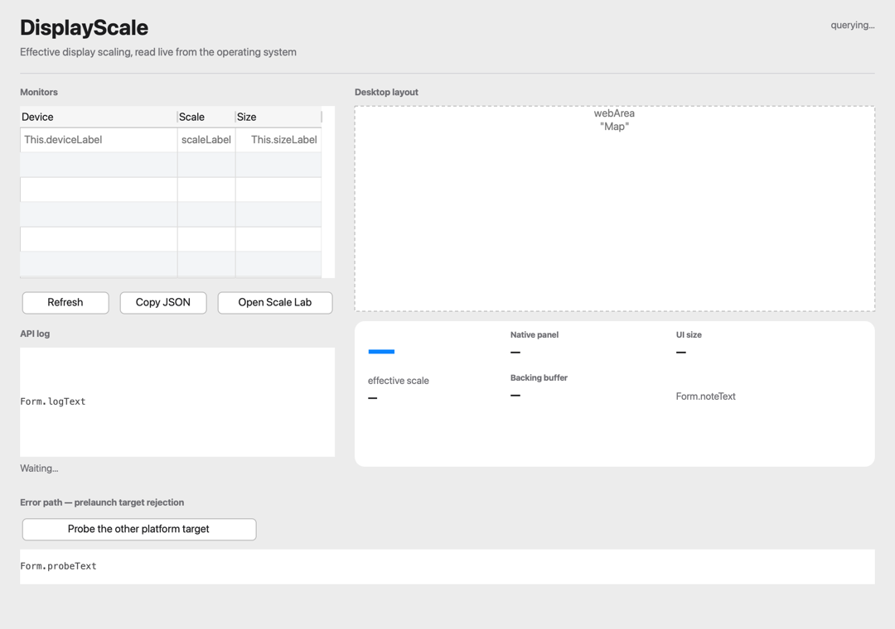
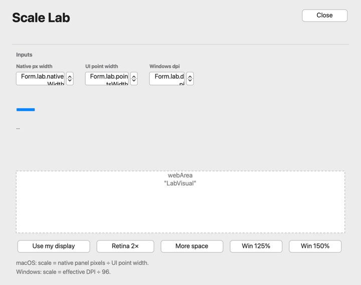

# DisplayScale demo

An interactive 4D project that shows what the [DisplayScale](https://github.com/miyako/DisplayScale)
component actually answers, and why the number matters for layout decisions.

Two windows, one component call each time you interact:

| MonitorBoard | Scale Lab |
| --- | --- |
|  |  |
| Live monitor list, SVG desktop map, detail card, API log, cross-platform probe. | Type your own native/point/DPI numbers and watch the scale percentage and a to-scale preview change. |

## What it demonstrates

* **Component import and namespace** — the demo never re-implements display
  metrics; it calls `cs.DisplayScale.Display`.
* **On-demand native CLI** — every refresh runs the bundled `display-scale`
  binary again. Nothing is cached between calls, and the API log keeps the
  request/response trail.
* **Protocol 2 envelopes** — both shapes are rendered deliberately: the
  `{ok:true,value:…}` result and the `{ok:false,error:…}` failure envelope.
* **Cross-platform target selection** — `Try Windows-x64 here` asks for the
  other platform on purpose. The adapter rejects the mismatch *before* it looks
  for an executable, which is the cheapest way to show a real prelaunch error.
* **macOS point/pixel maths vs Windows DPI maths** — the Scale Lab shows both
  formulas side by side for the same numbers.
* **Form/class boundary** — `Form` is data, `DisplayScene` is behaviour: the
  form method routes events, the class owns state, formatting and HTML.

## Run it

Requirements: 4D 21.x (LTS 21.2 was used for the recorded runs) on macOS, or
tool4d for a headless smoke run.

1. Open `Project/DisplayScale-demo.4DProject` in 4D.
2. `onStartup` opens **MonitorBoard**; the **Demo** menu reopens it or opens
   **Scale Lab**.
3. Click a monitor row, then `Refresh` or `Copy JSON`; open the Scale Lab and
   type numbers, or press a preset.

The component is vendored in `Components/DisplayScale.4dbase`, so the project
runs without a Dependency Manager install. `Project/Sources/dependencies.json`
therefore declares no dependency: the public `0.1.3` release ships a Windows
x64 CLI only, while this demo needs a working macOS CLI.

### The bundled macOS CLI

`Components/DisplayScale.4dbase/Resources/bin/macOS/display-scale` is built from
the component sources (`cli/display-scale` → `main.cpp`) with:

```sh
clang++ -std=c++17 -O2 -mmacosx-version-min=11.0 main.cpp \
  -framework CoreGraphics -framework CoreFoundation -o display-scale
```

`scripts/install-component.sh` does this for you when a sibling
`../DisplayScale` checkout exists, and otherwise keeps the vendored binary.
That binary is unsigned and macOS-arm64-only; it is a demo convenience, not a
replacement for the signed universal CLI the component's release pipeline
produces.

## Project layout

```
Project/DisplayScale-demo.4DProject        plain-text project (tokenizedText:false)
Project/Sources/Classes/DisplayScene.4dm   state, formatting, SVG/HTML
Project/Sources/Forms/MonitorBoard/        board form + form method
Project/Sources/Forms/ScaleLab/            lab form + form method
Project/Sources/Methods/                   Demo_* helpers (menu, lab updates)
Project/Sources/DatabaseMethods/           onStartup → Demo_OpenBoard
Project/Sources/styleSheets.css            palette, dark-mode overrides
Components/DisplayScale.4dbase/            vendored component (source + CLI)
scripts/make_forms.py                      regenerates the two .4DForm files
scripts/install-component.sh               refreshes the vendored component
docs/FINDINGS.md                           chokepoints and non-obvious findings
Documentation/                             architecture and API notes
```

## CLI contract this demo relies on

```
display-scale monitors   → {"protocol":2,"platform":"macos",
                            "monitors":[{"device":…,"primary":…,"bounds":…,
                            "backingPixels":…,"nativePixels":…,
                            "backingScalePercent":…,"scalePercent":…}]}
display-scale --version  → {"protocol":2,"version":"0.1.3"}
```

* macOS scale: `nativeWidth / pointWidth × 100`
* Windows scale: `dpi / 96 × 100`
* Failures arrive as `{"protocol":2,"error":{"code":"…","message":"…"}}` inside
  a failed result envelope, never as a thrown 4D error.

## Verification status

Recorded on macOS 27.2.1 (arm64) with 4D 21.2 LTS build 100694:

* *passed* — `monitors()` on a live display, listbox binding, detail card,
  SVG map HTML, Scale Lab presets and formula labels, JSON copy, API log,
  cross-platform probe → `unsupported_architecture`.
* *not run* — Windows host, Intel macOS, signed/universal CLI.
* *passed* — headless `Compile project` (tool4d 21.2 and 21R4, full 4D):
  `success: true`; see [docs/FINDINGS.md](docs/FINDINGS.md) §2.

## License

Demo code is MIT. The vendored component, its CLI and its documentation remain
under the terms of [miyako/DisplayScale](https://github.com/miyako/DisplayScale);
see `Components/DisplayScale.4dbase/Resources/licenses/`.
